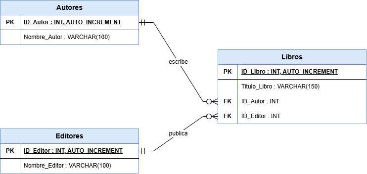

# Base de datos para una biblioteca (3FN)

## Descripción del proyecto

Este proyecto es una base de datos en **MySQL** para registrar los libros de una biblioteca. Cada libro tiene un **título**, un **autor** y un **editor**.

La información está repartida en tres tablas (`Autores`, `Editores` y `Libros`) para que los datos no se repitan y queden ordenados. Así la base de datos cumple la **Tercera Forma Normal (3FN)**.

**Archivos del proyecto:**

| Archivo | Contenido |
|---|---|
| `biblioteca.sql` | Crea la base de datos y las tablas, inserta los datos de prueba y trae las consultas. |
| `Diagrama_de_la_Biblioteca.drawio.png` | Diagrama entidad-relación hecho en draw.io. |
| `README.md` | Esta documentación. |

## Objetivo del ejercicio

Diseñar una base de datos para registrar libros que:

- Guarde la información de autores, editores y libros sin repetir datos.
- Relacione las tablas con claves primarias y claves foráneas.
- Cumpla con la 1FN, la 2FN y la 3FN, sin dependencias transitivas.

## Estructura de la base de datos

La base de datos se llama `Biblioteca` y tiene tres tablas:

```
Biblioteca
├── Autores   (los autores)
├── Editores  (los editores)
└── Libros    (los libros, conectados con su autor y su editor)
```

### Tabla `Autores`

Guarda los autores. Cada autor se escribe una sola vez.

| Campo | Tipo | Restricciones | Descripción |
|---|---|---|---|
| `ID_Autor` | `INT` | `PRIMARY KEY`, `AUTO_INCREMENT`, `NOT NULL` | Número que identifica a cada autor. |
| `Nombre_Autor` | `VARCHAR(100)` | `NOT NULL` | Nombre completo del autor. |

### Tabla `Editores`

Guarda los editores. Cada editor se escribe una sola vez.

| Campo | Tipo | Restricciones | Descripción |
|---|---|---|---|
| `ID_Editor` | `INT` | `PRIMARY KEY`, `AUTO_INCREMENT`, `NOT NULL` | Número que identifica a cada editor. |
| `Nombre_Editor` | `VARCHAR(100)` | `NOT NULL` | Nombre del editor o editorial. |

### Tabla `Libros`

Guarda los libros. En lugar de escribir el nombre del autor y del editor, guarda su **número de ID**.

| Campo | Tipo | Restricciones | Descripción |
|---|---|---|---|
| `ID_Libro` | `INT` | `PRIMARY KEY`, `AUTO_INCREMENT`, `NOT NULL` | Número que identifica a cada libro. |
| `Titulo_Libro` | `VARCHAR(150)` | `NOT NULL` | Título del libro. |
| `ID_Autor` | `INT` | `FOREIGN KEY`, `NOT NULL` | Autor del libro. Apunta a `Autores.ID_Autor`. |
| `ID_Editor` | `INT` | `FOREIGN KEY`, `NOT NULL` | Editor del libro. Apunta a `Editores.ID_Editor`. |

## Relaciones entre las tablas

- **Autores → Libros (uno a muchos):** un autor puede escribir varios libros, pero cada libro tiene un solo autor.
- **Editores → Libros (uno a muchos):** un editor puede publicar varios libros, pero cada libro tiene un solo editor.

Estas relaciones se ven en los datos de prueba. Por ejemplo, *Alex Fidal* (ID 1) aparece en dos libros, y *Editorial Horizonte* (ID 1) también publica dos libros.

## Claves primarias y foráneas

**Clave primaria (`PRIMARY KEY`):** es el campo que identifica a cada registro sin confusión. No se puede repetir ni quedar vacío. En este proyecto son `ID_Autor`, `ID_Editor` e `ID_Libro`. Gracias a `AUTO_INCREMENT`, MySQL les asigna el número solo (1, 2, 3...).

**Clave foránea (`FOREIGN KEY`):** es un campo de una tabla que guarda la clave primaria de otra tabla. Sirve para conectarlas. En `Libros`:

- `ID_Autor` apunta a `Autores(ID_Autor)`.
- `ID_Editor` apunta a `Editores(ID_Editor)`.

La clave foránea también **protege los datos**: MySQL no deja registrar un libro con un `ID_Autor` o un `ID_Editor` que no existan.

Por eso `Libros` se crea **de última**. Sus claves foráneas apuntan a `Autores` y `Editores`, y esas tablas tienen que existir primero.

## Normalización

Normalizar es organizar las tablas para que los datos no se repitan y no haya información contradictoria.

### Primera Forma Normal (1FN)

Una tabla está en 1FN cuando:

- Cada campo guarda **un solo valor** (nada de listas como "Autor1, Autor2").
- Cada registro se puede identificar con una clave primaria.
- No hay columnas repetidas como `Autor1`, `Autor2`, `Autor3`.

**En nuestro diseño:** cada campo tiene un solo dato (un nombre, un título o un número), y cada tabla tiene su clave primaria. ✅

### Segunda Forma Normal (2FN)

Una tabla está en 2FN cuando:

- Ya está en 1FN.
- Todos los campos dependen de la clave primaria **completa**.

Esta regla importa cuando la clave primaria está formada por dos o más campos. **En nuestro diseño** cada tabla tiene una clave primaria de un solo campo, así que todos los demás campos dependen de ella completa. Por ejemplo, `Titulo_Libro` depende de `ID_Libro`. ✅

### Tercera Forma Normal (3FN)

Una tabla está en 3FN cuando:

- Ya está en 2FN.
- **No tiene dependencias transitivas.**

**¿Qué es una dependencia transitiva?** Es cuando un campo no depende directamente de la clave primaria, sino de otro campo que no es clave.

Imaginemos una sola tabla con todo junto:

| ID_Libro | Titulo_Libro | ID_Autor | Nombre_Autor | ID_Editor | Nombre_Editor |
|---|---|---|---|---|---|
| 1 | How To Fly a F-14 Tomcat for duumies | 1 | Alex Fidal | 1 | Editorial Horizonte |
| 2 | El Libro Rojo | 1 | Alex Fidal | 2 | Ediciones Cordillera |
| 3 | El Tiempo: Misterios Del Mundo | 2 | Maria Antonieta De Las Nieves | 1 | Editorial Horizonte |

Aquí `Nombre_Autor` no depende del libro, sino del autor:

```
ID_Libro → ID_Autor → Nombre_Autor
```

Eso es una **dependencia transitiva**, y lo mismo pasa con `Nombre_Editor`. Trae problemas:

- **Datos repetidos:** "Alex Fidal" se escribe en cada libro suyo.
- **Errores al actualizar:** si el nombre cambia, hay que corregirlo en todas las filas, y si se olvida una, quedan datos contradictorios.
- **Datos que se pierden:** si se borra el único libro de un autor, también se borra el autor.

**Solución:** separamos los autores en la tabla `Autores` y los editores en la tabla `Editores`. En `Libros` solo guardamos `ID_Autor` e `ID_Editor`. Así cada nombre se escribe una sola vez, y en `Libros` todos los campos dependen directamente de `ID_Libro`. ✅

## Instrucciones para ejecutar el proyecto

**Requisitos:** tener MySQL instalado y conocer la contraseña del usuario `root`.

### Opción 1: MySQL Workbench

1. Abrir **MySQL Workbench** y entrar a la conexión local con el usuario `root`.
2. Ir a **File → Open SQL Script...** y elegir `biblioteca.sql`.
3. Ejecutar todo el script con el botón del rayo ⚡ (*Execute*) o con `Ctrl + Shift + Enter`.
4. Abajo aparecen los resultados de las consultas, cada uno en su propia pestaña.

### Opción 2: terminal (cmd o PowerShell)

1. Abrir la terminal en la carpeta donde está `biblioteca.sql`.
2. Entrar a MySQL:
   ```
   mysql -u root -p
   ```
3. Escribir la contraseña y luego ejecutar el archivo:
   ```sql
   SOURCE biblioteca.sql;
   ```

> **Nota:** el script empieza con `DROP DATABASE IF EXISTS Biblioteca;`. Esa línea borra la base de datos si ya existía, para que el archivo se pueda ejecutar varias veces sin errores.

## Consultas de prueba

```sql
-- 1. Mostrar todos los autores
SELECT * FROM Autores;

-- 2. Mostrar todos los editores
SELECT * FROM Editores;

-- 3. Mostrar todos los libros
SELECT * FROM Libros;

-- 4. Mostrar los libros con su autor y su editor
SELECT
    Libros.ID_Libro,
    Libros.Titulo_Libro,
    Autores.Nombre_Autor,
    Editores.Nombre_Editor
FROM Libros
INNER JOIN Autores  ON Libros.ID_Autor  = Autores.ID_Autor
INNER JOIN Editores ON Libros.ID_Editor = Editores.ID_Editor
ORDER BY Libros.ID_Libro;
```

## Resultados esperados

**1. Autores**

| ID_Autor | Nombre_Autor |
|---|---|
| 1 | Alex Fidal |
| 2 | Maria Antonieta De Las Nieves |
| 3 | Camila Ortega Suárez |

**2. Editores**

| ID_Editor | Nombre_Editor |
|---|---|
| 1 | Editorial Horizonte |
| 2 | Ediciones Cordillera |
| 3 | Editorial Río Claro |

**3. Libros**

| ID_Libro | Titulo_Libro | ID_Autor | ID_Editor |
|---|---|---|---|
| 1 | How To Fly a F-14 Tomcat for duumies | 1 | 1 |
| 2 | El Libro Rojo | 1 | 2 |
| 3 | El Tiempo: Misterios Del Mundo | 2 | 1 |
| 4 | Ferrari | 3 | 3 |
| 5 | El Arte De La Guerra | 2 | 3 |

**4. Libros con su autor y su editor (`INNER JOIN`)**

| ID_Libro | Titulo_Libro | Nombre_Autor | Nombre_Editor |
|---|---|---|---|
| 1 | How To Fly a F-14 Tomcat for duumies | Alex Fidal | Editorial Horizonte |
| 2 | El Libro Rojo | Alex Fidal | Ediciones Cordillera |
| 3 | El Tiempo: Misterios Del Mundo | Maria Antonieta De Las Nieves | Editorial Horizonte |
| 4 | Ferrari | Camila Ortega Suárez | Editorial Río Claro |
| 5 | El Arte De La Guerra | Maria Antonieta De Las Nieves | Editorial Río Claro |

### Prueba de la clave foránea (opcional)

Para comprobar que las claves foráneas protegen los datos, se puede intentar registrar un libro con un autor que no existe:

```sql
INSERT INTO Libros (Titulo_Libro, ID_Autor, ID_Editor) VALUES ('Libro de prueba', 99, 1);
```

MySQL debe **rechazarlo** con un error parecido a `Cannot add or update a child row: a foreign key constraint fails`. Eso confirma que la relación funciona.

## Diagrama entidad-relación

El diagrama se hizo en draw.io y está en el archivo `Diagrama_de_la_Biblioteca.drawio.png`.



**Cómo leerlo:**

- `PK` = clave primaria (aparece subrayada). `FK` = clave foránea.
- La línea **"escribe"** une `Autores.ID_Autor` con `Libros.ID_Autor`, y la línea **"publica"** une `Editores.ID_Editor` con `Libros.ID_Editor`.
- Las dos rayitas (`||`) en el lado de Autores y Editores significan **uno**: cada libro tiene exactamente un autor y un editor.
- El círculo con "patas de gallo" en el lado de Libros significa **cero o muchos**: un autor (o editor) puede tener cero, uno o varios libros.

## Conclusión

Separar la información en tres tablas (`Autores`, `Editores` y `Libros`) evita repetir datos y elimina las dependencias transitivas, así que la base de datos queda en **Tercera Forma Normal**. Las claves primarias identifican cada registro, y las claves foráneas conectan los libros con su autor y su editor. Además, impiden que se guarden datos que no existen.

Con `INNER JOIN` se vuelve a juntar la información de las tres tablas para verla completa en una sola consulta, sin necesidad de guardarla repetida.
